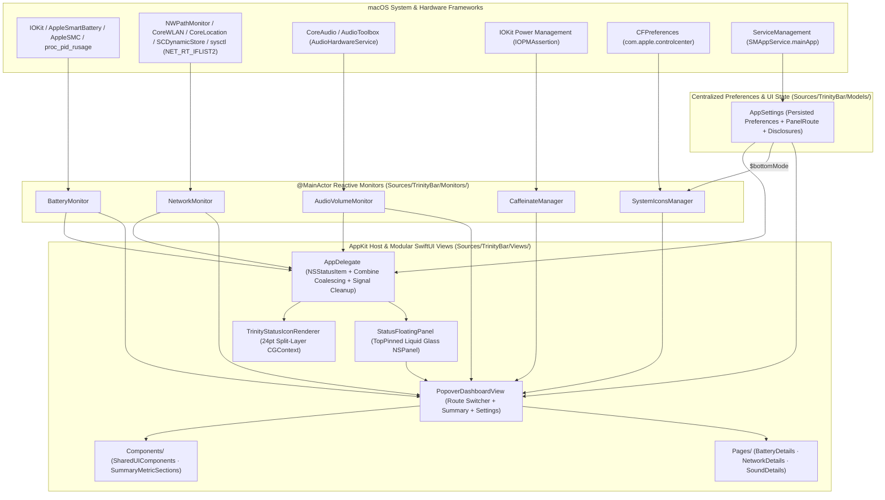

# TrinityBar Architecture & Extension Guide

This document describes **TrinityBar**'s internal architecture, hardware telemetry pipelines, rendering/layout mechanics, build constraints, and how to extend the codebase cleanly.

---

## 1. System Architecture



---

## 2. Core Technical Design Decisions

### 2.1 Split-Layer `24pt` Menu Bar Emblem (`TrinityEmblemView.swift` + `TrinityBarApp.swift`)
1. **Bypassing `NSButtonCell`'s `18pt` Image Clamp**:
   - Standard `NSStatusBarButton` cells downscale images taller than `18pt`.
   - `AppDelegate` assigns a transparent `24x18` placeholder `NSImage` to `button.image` to reserve exact menu bar width, then mounts two custom non-hit-testing `UnscaledStatusBarImageView` subviews (`imageScaling = .scaleNone`) centered inside `button.bounds`.
2. **Template Vibrancy Base + Chromatic Status Overlay**:
   - `templateImageView` (`isTemplate = true`): Renders neutral monochrome strokes (Wi-Fi fan, inactive grooves, `%` digits, volume dots/arc) so macOS automatically applies wallpaper-aware menu bar vibrancy.
   - `chromaticImageView` (`isTemplate = false`): Renders semantic state colors (green charging/plugged-in brackets & bolt, yellow low-power bracket, red critical battery) above the template layer without vibrancy desaturation.
3. **Independent `CGPath` Subpaths (Open Top Crown)**:
   - Calling `CGMutablePath.addArc(...)` twice on the same mutable path connects the first arc's endpoint to the second arc's start point with a straight line chord — which would cut across the top `%` number or charging bolt.
   - `TrinityStatusIconRenderer.singleArcPath(...)` constructs each arc segment in its own `CGMutablePath` and merges them via `path.addPath(...)`, keeping the top crown cutout and bottom footer breaks completely open.

### 2.2 Zero-Flash Liquid Glass Panel Resize (`StatusFloatingPanel.swift`)
Animating height changes (`Settings` expand/collapse or `Summary <-> Detail` page navigation) inside an AppKit `NSPanel` hosting SwiftUI encounters a subtle frame-0 timing hazard:
- If `NSHostingView.frame.height` matches the collapsed window height (`~328pt`), toggling `summarySettingsExpanded = true` causes SwiftUI to lay out `~457pt` inside a `328pt` `NSHostingView` on **click frame 0** (before the window frame animation begins on the next runloop tick). `NSHostingView` vertically centers the overflow (`y = -64.5pt`), creating a 1-frame upward flash.
- **How TrinityBar Eliminates It**:
  1. `TopPinnedContainerView` overrides `isFlipped = true` so `(0, 0)` is anchored to the top-left of the clipped `NSGlassEffectView` (`masksToBounds = true`).
  2. `hosting.view.frame` is kept permanently at `332 x 1600` (`permanentHostingCanvasHeight`), while `PopoverDashboardView` ends with `Spacer(minLength: 0)`.
  3. Because `Spacer(minLength: 0)` contributes `0` minimum height, `hosting.fittingSize.height` still returns the exact intrinsic height of the active route/drawer (`328pt` collapsed, `457pt` expanded), while top content stays pinned at `y = 0` on every frame (`0px` vertical drift).

### 2.3 Low-Overhead Hardware Monitors (`Monitors/`)
All monitors are `@MainActor ObservableObject` classes designed to keep idle background CPU near `0%` by gating active polling behind `setPopoverVisible(_ visible: Bool)`:

- **`BatteryMonitor.swift`**:
  - **Background**: Event-driven `IOPSNotificationCreateRunLoopSource` + `NSProcessInfoPowerStateDidChange` + `30s` fallback timer reading `IOPSCopyPowerSourcesInfo` and `AppleSmartBattery` IORegistry properties (including desktop Mac `hasBattery == false` AC-only handling).
  - **Popover Open (`2s` timer)**: Offloads read-only `AppleSMC` FourCC power keys (`PSTR`, `PDTR`, `PDBR`/`PBLR`, `DnJV`/`DnJI`) and per-app `proc_pid_rusage` (`RUSAGE_INFO_V6` `ri_energy_nj` / `mach_timebase_info`-scaled CPU deltas) onto `Task.detached(priority: .utility)` so the main thread never stalls, excluding headless `/System/Library/` OS daemons and cancelling in-flight tasks when the panel closes.
- **`NetworkMonitor.swift`**:
  - **Background**: Event-driven `NWPathMonitor`, `CoreWLAN` (`CWWiFiClient`), and `SCDynamicStore` (`State:/Network/Global/IPv4`, `DNS`) callbacks.
  - **Popover Open**: `1.5s` 64-bit `sysctl` (`NET_RT_IFLIST2` / `RTM_IFINFO2` / `if_data64`) throughput delta sampler (avoiding 32-bit 4 GiB wraparound), non-blocking TCP `NWConnection` latency probe, async `CWInterface.scanForNetworks(withSSID:)` scanner, and one-click `CWInterface.associate(to:password:nil)` switching for Known Networks.
- **`AudioVolumeMonitor.swift`**:
  - **Purely Event-Driven**: Registers `AudioObjectAddPropertyListener` callbacks on `kAudioHardwarePropertyDefaultOutputDevice`, `kAudioHardwarePropertyDefaultInputDevice`, `kAudioHardwarePropertyDevices`, `kAudioHardwareServiceDeviceProperty_VirtualMainVolume`, and `kAudioDevicePropertyMute`.
  - **Loopback Driver Filtering**: Checks `kAudioDevicePropertyDeviceCanBeDefaultDevice == 1` in the target scope — matching macOS **System Settings → Sound** so internal virtual loopback drivers (e.g., `Microsoft Teams Audio` / `MSLoopbackDriverDevice_UID`) are excluded while physical, Bluetooth, USB, HDMI, and AirPlay endpoints remain selectable.
  - **Soft-Mute Fallback**: Devices without settable hardware `kAudioDevicePropertyMute` (common on Bluetooth headsets) transparently fall back to storing pre-mute volume and setting virtual main volume to `0.0`.
- **`CaffeinateManager.swift`**:
  - Manages `kIOPMAssertionTypePreventUserIdleDisplaySleep` with persisted duration presets (`30m / 1h / 2h / ∞`) and a `.common`-mode countdown timer that releases the assertion on expiry or post-wake check.
- **`SystemIconsManager.swift`**:
  - Uses a table-driven `ManagedControlCenterItem` list (`WiFi`, `Battery`, `Sound`) to snapshot and manage `com.apple.controlcenter` preferences (`byHost` visibility integer + `NSStatusItem Visible <key>`), persisting the user's `Hide Native Icons` preference across restarts with crash-recovery restoration.
  - Coordinates automatically with `AppSettings.$bottomMode`: switching `Volume Bar` to `None` immediately surfaces the native macOS `Sound` status bar icon while keeping `WiFi` and `Battery` hidden; exiting TrinityBar (`Quit`, `⌘Q`, `SIGTERM`, `SIGINT`) flushes state and restores all original snapshots.

### 2.4 Build Pipeline & Bundle Size Optimization (`scripts/`)
- **`scripts/build_app.sh`** compiles directly via `swiftc -Osize -whole-module-optimization -parse-as-library -strict-concurrency=complete -warnings-as-errors -Xlinker -dead_strip` followed by `strip -x`, producing a **`~565 KB`** arm64 executable without requiring external SwiftPM macro plugin binaries.
  - **Important Constraint**: Do not introduce `@State` (which depends on the `SwiftUIMacros` compiler plugin) inside `View` structs; store transient navigation or disclosure flags as `@Published` properties on `AppSettings`.
- **`scripts/generate_icon.swift`** renders a crisp `1024x1024` vector squircle icon and writes a single-chunk `ic10` PNG-backed `AppIcon.icns` (**`66 KB`**), keeping the entire packaged `TrinityBar.app` (`v1.1.1`) at **`~656 KB`**.

---

## 3. Extension Guide

### 3.1 Adding a New Module & Drill-Down Page (e.g., Bluetooth or Display)
1. **Monitor**: Create `Sources/TrinityBar/Monitors/<Domain>Monitor.swift` (`@MainActor final class <Domain>Monitor: ObservableObject`). Gate any high-frequency sampling inside `setPopoverVisible(_ visible: Bool)`.
2. **Route**: Add a case to `PanelRoute` in `Sources/TrinityBar/Models/AppSettings.swift`:
   ```swift
   enum PanelRoute: Equatable, Sendable {
       case summary
       case battery
       case network
       case sound
       case bluetooth // <-- new route
   }
   ```
3. **Summary Sub-Cards**: Add `<Domain>InfoBarSection` in `Sources/TrinityBar/Views/Components/SummaryMetricSections.swift` using `SummaryGlassMetricCard` (`height: 40pt`, `cornerRadius: 10pt`).
4. **Detail Page**: Create `Sources/TrinityBar/Views/Pages/<Domain>DetailsPageView.swift` using `NavigationBackHeader`, `CollapsibleSectionHeader`, `DetailKeyValueRow`, and `SettingsExternalLinkRow`.
5. **Dashboard Wiring**:
   - Add a `SummaryModuleHeaderRow` + `<Domain>InfoBarSection` block inside `PopoverDashboardView.summaryContent`.
   - Route `.bluetooth` inside `PopoverDashboardView.body`'s `switch settings.route` (`StatusFloatingPanel` automatically measures and animates to the new route's `fittingSize`).
6. **Build Script**: `scripts/build_app.sh` automatically discovers all `Sources/TrinityBar/**/*.swift` files — no manual file list update required.

### 3.2 Managing Additional Native Control Center Icons
Append one `ManagedControlCenterItem` entry to `SystemIconsManager.managedItems` in `Sources/TrinityBar/Monitors/SystemIconsManager.swift`:
```swift
ManagedControlCenterItem(
    moduleKey: "Bluetooth",
    snapshotTag: "BT",
    hiddenHostCode: 8
)
```
Snapshot capture, hiding, toggle-off restoration, and termination signal restoration will include the new item automatically.
