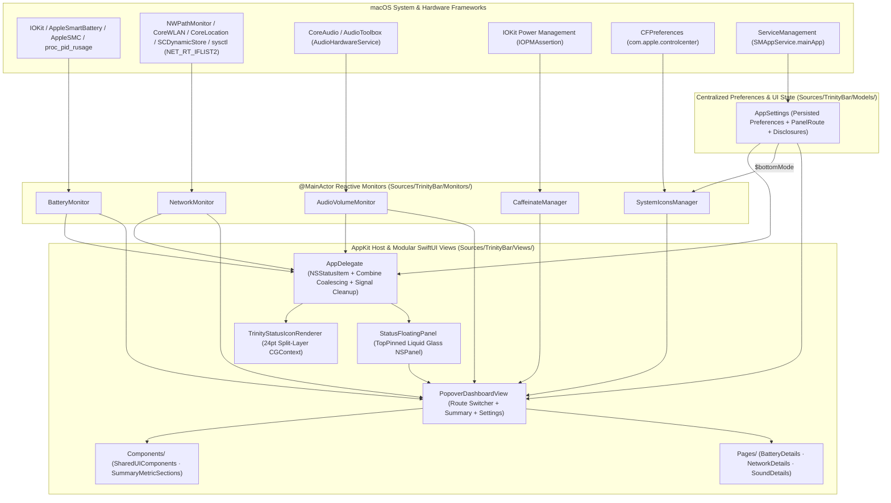

# TrinityBar Architecture & Extension Guide

This document describes **TrinityBar**'s internal architecture, hardware telemetry pipelines, rendering/layout mechanics, build constraints, and how to extend the codebase cleanly.

---

## 1. System Architecture



---

## 2. Core Technical Design Decisions

### 2.1 Split-Layer `24pt` Menu Bar Emblem (`TrinityEmblemView.swift` + `TrinityBarApp.swift`)
1. **Bypassing `NSButtonCell`'s `18pt` Image Clamp**:
   - Standard `NSStatusBarButton` cells downscale images taller than `18pt`.
   - `AppDelegate` assigns a transparent `24x18` placeholder `NSImage` to `button.image` to reserve exact menu bar width, then mounts two custom non-hit-testing `UnscaledStatusBarImageView` subviews (`imageScaling = .scaleNone`) centered inside `button.bounds`.
2. **Template Vibrancy Base + Chromatic Status Overlay**:
   - `templateImageView` (`isTemplate = true`): Renders neutral monochrome strokes (Wi-Fi fan, inactive grooves, `%` digits, volume dots/arc) so macOS automatically applies wallpaper-aware menu bar vibrancy.
   - `chromaticImageView` (`isTemplate = false`): Renders semantic state colors (green charging/plugged-in brackets & bolt, yellow low-power bracket, red critical battery) above the template layer without vibrancy desaturation.
3. **Independent `CGPath` Subpaths (Open Top Crown)**:
   - Calling `CGMutablePath.addArc(...)` twice on the same mutable path connects the first arc's endpoint to the second arc's start point with a straight line chord — which would cut across the top `%` number or charging bolt.
   - `TrinityStatusIconRenderer.singleArcPath(...)` constructs each arc segment in its own `CGMutablePath` and merges them via `path.addPath(...)`, keeping the top crown cutout and bottom footer breaks completely open.
4. **Hover-Scoped Scroll-to-Volume**:
   - An `NSTrackingArea` (`.mouseEnteredAndExited`, `.activeAlways`, `.inVisibleRect`) on the status button, owned by `StatusItemHoverTracker`, attaches the global + local `.scrollWheel` monitors only while `Icon Volume Control` is on **and** the pointer is over the emblem, and removes them on exit. Scrolling in other apps therefore never wakes TrinityBar (a permanent global monitor fired on every scroll event system-wide). A scroll that lands outside the button also detaches the monitors, as a safety net for a missed `mouseExited`.
   - With Volume Bar `None`, a scroll on the emblem draws the volume dots for `1.5 s` (`TrinityEmblemState.footerMode(setting:showsTransientVolumeFooter:)`) so the change is visible.

### 2.2 Zero-Flash Liquid Glass Panel Resize (`StatusFloatingPanel.swift`)
Animating height changes (`Settings` expand/collapse or `Summary <-> Detail` page navigation) inside an AppKit `NSPanel` hosting SwiftUI encounters a subtle frame-0 timing hazard:
- If `NSHostingView.frame.height` matches the collapsed window height (`~328pt`), toggling `summarySettingsExpanded = true` causes SwiftUI to lay out `~457pt` inside a `328pt` `NSHostingView` on **click frame 0** (before the window frame animation begins on the next runloop tick). `NSHostingView` vertically centers the overflow (`y = -64.5pt`), creating a 1-frame upward flash.
- **How TrinityBar Eliminates It**:
  1. `TopPinnedContainerView` overrides `isFlipped = true` so `(0, 0)` is anchored to the top-left of the clipped `NSGlassEffectView` (`masksToBounds = true`).
  2. `hosting.view.frame` is kept permanently at `332 x 1600` (`permanentHostingCanvasHeight`), while `PopoverDashboardView` ends with `Spacer(minLength: 0)`.
  3. Because `Spacer(minLength: 0)` contributes `0` minimum height, `hosting.fittingSize.height` still returns the exact intrinsic height of the active route/drawer (`328pt` collapsed, `457pt` expanded), while top content stays pinned at `y = 0` on every frame (`0px` vertical drift).

### 2.3 Low-Overhead Hardware Monitors (`Monitors/`)
All monitors are `@MainActor ObservableObject` classes designed to keep idle background CPU near `0%` by gating active polling behind `setPopoverVisible(_ visible: Bool)`:

- **`BatteryMonitor.swift`**:
  - **Background**: Event-driven `IOPSNotificationCreateRunLoopSource` + `NSProcessInfoPowerStateDidChange` + `30s` fallback timer reading only `IOPSCopyPowerSourcesInfo` (including desktop Mac `hasBattery == false` AC-only handling). The `AppleSmartBattery` IORegistry dictionary (health, cycles, temperature, voltage) feeds only the panel, so it is skipped while the panel is closed. The battery is chosen with `selectInternalBattery`, which accepts only `kIOPSInternalBatteryType` entries that aren't flagged not-present, so a UPS listed first (or alone, on a desktop Mac) is never mistaken for the built-in battery.
  - **Charge hold reason**: plugged in but not charging, `chargeHoldReason(description:)` publishes `chargeHold`: `.optimized` when IOPS reports `Optimized Battery Charging Engaged`, `.charged` for the documented `kIOPSIsChargedKey`, otherwise `.onHold` (charge limit, temperature or top-off pause). The panel subtitle and the Battery page show it instead of a generic "Connected to power". The undocumented `ChargerData.NotChargingReason` bitmask is deliberately not decoded.
  - **Popover Open (`2s` timer)**: Reads the `AppleSmartBattery` IORegistry entry and the read-only `AppleSMC` FourCC power keys (`PSTR`, `PDTR`, `PDBR`/`PBLR`, `DnJV`/`DnJI`) and per-app `proc_pid_rusage` (`RUSAGE_INFO_V6` `ri_energy_nj` / `mach_timebase_info`-scaled CPU deltas) onto `Task.detached(priority: .utility)` so the main thread never stalls, excluding headless `/System/Library/` OS daemons and cancelling in-flight tasks when the panel closes. The per-process High Energy Apps scan runs only while the Battery page is on screen (`setEnergyAppsPageVisible`, driven by `settings.$route`).
- **`NetworkMonitor.swift`**:
  - **Background**: Event-driven `NWPathMonitor`; every path update runs a full link refresh (SSID, IP, router, DNS). While the panel is closed and the link is Wi-Fi, a `20s` timer (`5s` tolerance) reads only power + RSSI for the emblem's bars (2 `airportd` round-trips instead of a full snapshot); on Ethernet or offline there is no timer at all (`needsBackgroundSignalTimer`). All synchronous `CoreWLAN` (`CWWiFiClient`, each getter is an XPC round-trip to `airportd`) and `SCDynamicStore` (`State:/Network/Global/IPv4`, `DNS`) reads run on a dedicated serial `linkQueue` into an immutable `LinkSnapshot`, which is applied on the main actor; overlapping refresh requests coalesce.
  - **Popover Open**: `1.5s` 64-bit `sysctl` (`NET_RT_IFLIST2` / `RTM_IFINFO2` / `if_data64`) throughput delta sampler (avoiding 32-bit 4 GiB wraparound), non-blocking TCP `NWConnection` latency probe, async `CWInterface.scanForNetworks(withSSID:)` scanner, and one-click `CWInterface.associate(to:password:nil)` switching for Known Networks.
- **`AudioVolumeMonitor.swift`**:
  - **Purely Event-Driven**: Two `AudioObjectAddPropertyListenerBlock` listeners — system-level (`kAudioHardwarePropertyDefaultOutputDevice`, `kAudioHardwarePropertyDefaultInputDevice`, `kAudioHardwarePropertyDevices`) triggers a full device re-enumeration, while the active output's `kAudioHardwareServiceDeviceProperty_VirtualMainVolume` / `kAudioDevicePropertyMute` listener only re-reads the two scalars, so scroll-driven volume changes never enumerate every device. System-level events are coalesced: the burst a headset connection fires produces one enumeration `150 ms` after the first event.
  - **Loopback Driver Filtering**: Checks `kAudioDevicePropertyDeviceCanBeDefaultDevice == 1` in the target scope — matching macOS **System Settings → Sound** so internal virtual loopback drivers (e.g., `Microsoft Teams Audio` / `MSLoopbackDriverDevice_UID`) are excluded while physical, Bluetooth, USB, HDMI, and AirPlay endpoints remain selectable.
  - **Soft-Mute Fallback**: Devices without settable hardware `kAudioDevicePropertyMute` (common on Bluetooth headsets) transparently fall back to storing pre-mute volume and setting virtual main volume to `0.0`.
  - **Fixed-Volume Outputs**: Outputs whose `VirtualMainVolume` isn't settable (HDMI / DisplayPort audio, Multi-Output aggregate devices, some USB DACs) publish `isVolumeControllable == false`. The emblem footer then shows no lit dots or arc, the volume card shows `—`, the slider is dimmed and ignores input, scroll-to-volume does nothing, and mute is disabled unless hardware mute is settable (`isMuteControllable`). This replaces showing the previous device's stale level. The display mapping is the pure `volumeDots` / `effectiveProgress` / `volumeLevelText(volume:isMuted:isVolumeControllable:)`, covered by `VolumeDisplayTests`.
- **`CaffeinateManager.swift`**:
  - Manages `kIOPMAssertionTypePreventUserIdleDisplaySleep` with persisted duration presets (`30m / 1h / 2h / ∞`) and a `.common`-mode countdown timer that releases the assertion on expiry or post-wake check.
  - **Display-aware countdown cadence**: `remainingBadgeText` is clock-style (`H:MM:SS` with an hour or more left, otherwise `M:SS`, via the pure `formatRemaining(seconds:)`). `AppDelegate` sets `isDisplayActive` when `StatusFloatingPanel` is presented and in its `onClose`. While the panel is visible the one-shot timer re-arms just past each whole-second boundary (`0.05 s` tolerance) so the badge ticks every second; while it is hidden it re-arms on minute boundaries (≈40× fewer wakeups), and flipping `isDisplayActive` back on refreshes the text immediately. Expiry always derives from the absolute `expiresAt`, so it fires on time in either mode. The badge `Text` is `.monospacedDigit().lineLimit(1).fixedSize()` so width changes never feed back into `syncHeightToContent`.
- **`SystemIconsManager.swift`**:
  - Uses a table-driven `ManagedControlCenterItem` list (`WiFi`, `Battery`, `Sound`) to snapshot and manage `com.apple.controlcenter` preferences (`byHost` visibility integer + `NSStatusItem Visible <key>`), persisting the user's `Hide Native Icons` preference across restarts with crash-recovery restoration.
  - All reads and writes go through an injected `ControlCenterPreferences` (production: `CFControlCenterPreferences`), a `UserDefaults` for TrinityBar's snapshots, and a restart closure (production: `killall ControlCenter`). `SystemIconsManagerTests` drives the whole hide / snapshot / restore policy against an in-memory fake, so changes to this module must keep those tests green.
  - **Unverified macOS versions**: the visibility codes (`24` / `8` / `18`) and `NSStatusItem Visible*` keys are undocumented, so `SystemIconsManager.verifiedMacOSMajorVersions` lists the major versions where hide + restore were checked by hand (currently `26`, `27`). On any other version, Hide Native Icons starts off (a crash-leftover hidden state is restored at launch) and the Settings drawer explains why. Turning it on records an opt-in for that major version only. When verifying a new macOS release, test hide / restore / Volume Bar `None` there, then add it to the set. `TRINITYBAR_ASSUME_MACOS_MAJOR=<n>` simulates another version for testing.
  - **Write verification & coalesced restarts**: after `CFPreferencesSynchronize`, every key written is read back, and mismatches are logged as `fault` (`lastUnverifiedWrites` in tests). Runtime policy changes schedule one `killall ControlCenter` `0.3 s` later, so flipping Volume Bar modes flashes the menu bar once. Quit, `SIGTERM` and `--restore-native-icons` flush it synchronously before exiting. After a restart, a fault is logged if ControlCenter hasn't relaunched within `3 s`.
  - **Crash recovery & single instance** (`Models/LaunchOptions.swift`, `TrinityBarMain.main`): snapshots live in TrinityBar's own defaults, so a crash or `SIGKILL` leaves icons hidden until the next launch. `TrinityBar --restore-native-icons` runs only `restoreNativeIconsIfNeeded()` and exits without UI (refusing while another instance is running); the README uninstall steps call it before `defaults delete` removes the snapshot. A second normal launch with the same bundle identifier calls `exit(0)` before `AppDelegate` exists. It deliberately avoids `NSApp.terminate`, whose `applicationWillTerminate` would restore the icons the running instance is hiding.
  - Coordinates automatically with `AppSettings.$bottomMode`: switching `Volume Bar` to `None` immediately surfaces the native macOS `Sound` status bar icon while keeping `WiFi` and `Battery` hidden; exiting TrinityBar (`Quit`, `⌘Q`, `SIGTERM`, `SIGINT`) flushes state and restores all original snapshots.
  - With `Hide Native Icons` OFF, `Volume Bar = None` still force-shows the native `Sound` icon, but first saves the user's own Sound setting into a separate `SoundForced` snapshot slot; switching back to `Dots` / `Arc`, enabling `Hide Native Icons`, or quitting hands that setting back.

### 2.4 Build Pipeline & Bundle Size Optimization (`scripts/`)
- **`scripts/build_app.sh`** compiles directly via `swiftc -swift-version 6 -Osize -whole-module-optimization -parse-as-library -strict-concurrency=complete -warnings-as-errors -Xlinker -dead_strip` followed by `strip -x`, producing a **`~634 KB`** arm64 executable without requiring external SwiftPM macro plugin binaries. `-swift-version 6` matches the Swift 6 language mode SwiftPM uses for `swift build` / `swift test` (`swift-tools-version: 6.0`), so the shipped binary gets the same compile-time errors and runtime actor-isolation checks as the tested one, not Swift 5 mode with concurrency diagnostics as warnings.
  - **Disclosure State Convention**: Store transient navigation and disclosure flags (`route`, `summarySettingsExpanded`, section expand toggles) as `@Published` properties on `AppSettings` rather than view-local `@State`. `@State` itself compiles fine under this `swiftc` pipeline (it is a property wrapper, not a macro), but `AppDelegate` subscribes to `settings.objectWillChange` to drive `StatusFloatingPanel.syncHeightToContent`, and reads `route` / `summarySettingsExpanded` for `Esc`, close, and scroll-to-volume handling — a flag moved into `@State` would expand or collapse content without resizing the panel. Avoid actual macros (`@Observable`, `#Preview`, `@Entry`), which do require the `SwiftUIMacros` plugin.
- **`scripts/generate_icon.swift`** renders a crisp `1024x1024` vector squircle icon and writes a single-chunk `ic10` PNG-backed `AppIcon.icns` (**`66 KB`**), keeping the entire packaged `TrinityBar.app` at **`~712 KB`**.
- **Versioning**: `MARKETING_VERSION` (`CFBundleShortVersionString`) and `BUILD_NUMBER` (`CFBundleVersion`) live only in the root `version.env`, which `build_app.sh` sources (failing fast if the file or either field is missing). The release workflow checks that a pushed `v*` tag matches `MARKETING_VERSION`. The full release procedure lives in [RELEASING.md](./RELEASING.md).


### 2.5 README Screenshots (`scripts/capture_screenshots.sh`)
`assets/dashboard-summary.png` and `assets/dashboard-settings.png` are generated, never hand-cropped. Regenerate them whenever the dashboard UI changes and before tagging a release:

1. **Prerequisites**: run from a terminal app that has **Screen Recording** permission (*System Settings → Privacy & Security → Screen & System Audio Recording*). Pick the wallpaper you want shown, and put the Mac in a representative state — e.g. unmuted at a mid volume, and the in-app preferences the shots should demonstrate (`Volume Bar = Dots`, `Top % Number` on). Screenshot mode never changes persisted settings, so battery / volume / Wi-Fi signal are captured live.
2. **Run** `./scripts/capture_screenshots.sh` (add `--no-build` to reuse `dist/`). Keep hands off the mouse/keyboard for ~20 s. The script quits any running TrinityBar (restoring native icons), and for each scene launches `dist/TrinityBar.app` with `TRINITYBAR_SCREENSHOT=<summary|settings>`.
3. **Screenshot mode** (`Models/ScreenshotMode.swift`):
   - Replaces identifying network details with neutral demo values (`Home Wi-Fi`, `192.168.1.20`, router `192.168.1.1`, DNS `1.1.1.1, 8.8.8.8`, synthetic BSSID / IPv6) before they reach any view, and hides the Location Services banner.
   - Covers the screen with a click-through window showing the current desktop wallpaper just below the menu bar level, so open app windows never appear behind the glass panel (falls back to a neutral dark fill if the wallpaper can't be loaded).
   - Keeps the panel at least `26pt` from the screen edges (normally `8pt`), so the capture's `25pt` side margins stay on-screen even when the emblem sits near the right edge.
   - Opens the panel on the requested scene after `2 s`, ignores outside clicks so it cannot be dismissed mid-capture, and after a further `5 s` (live latency / throughput) atomically writes panel + status button geometry in top-left-origin points to `TRINITYBAR_SCREENSHOT_INFO`.
4. **Capture & frame**: the script captures the region from the menu bar top to `28pt` below the panel, `25pt` either side (`382pt` → `764px` wide at 2×, cursor excluded), then `scripts/frame_screenshot.swift` scrubs the menu bar slice of everything except the TrinityBar emblem (other apps' status items, the clock, glyphs clipped by the crop: pixels deviating from each row's background are replaced by interpolating their unmarked neighbours, preserving the menu bar's own tint), clips it to an `18pt` rounded card with a hairline border, and writes `assets/dashboard-<scene>.png`. The installed `/Applications/TrinityBar.app` is relaunched if it was running.
5. **Review before committing**: both images should be `764px` wide; confirm no real SSID / IP / BSSID appears, the menu bar slice shows only the emblem, and no notification banner or other window leaked into the frame. Re-run if the clock, battery, or volume state looks unrepresentative. The README `` tags reference these fixed filenames at `width="382"`, so no README edit is needed unless scenes are added.

### 2.6 Testing & Continuous Integration (`Tests/`, `.github/workflows/`)
- **Unit tests** live in the SwiftPM `TrinityBarTests` target and run with `swift test`. They use **XCTest** (not Swift Testing, which needs macro plugins) and `@testable import TrinityBar` directly against the executable target, so there is no separate Core library and `build_app.sh` stays a single-module `swiftc` build.
- **What is tested**: pure logic only. Keep testable logic in `static` functions that take plain values and return plain values, mark them `nonisolated` when they sit on a `@MainActor` type (constants they read, such as `StatusFloatingPanel.menuBarGap` / `screenMargin`, need `nonisolated static let` too), and keep AppKit lookups in a thin wrapper. Example: `StatusFloatingPanel.computePanelFrame` only resolves the screen, then calls the pure `panelFrame(panelSize:anchorScreenRect:visibleFrame:horizontalInset:)`. Test classes that touch `@MainActor` types (`StatusFloatingPanel`, `TrinityStatusIconRenderer`) are themselves `@MainActor`.
- **`ci.yml`** runs on every push to `main` and every pull request (`macos-26`): `build_app.sh` (the shipped single-module, strict-concurrency, warnings-as-errors build), `scripts/check_docs.sh`, `swift build`, `swift test`.
- **`scripts/check_docs.sh`** catches mechanical documentation drift: every tracked file must appear in the README project tree (and every file named there must exist), README / ARCHITECTURE must not hard-code a release version, and the documented app / executable sizes must be within 10% of the freshly built `dist/TrinityBar.app`. It cannot judge whether prose is accurate; the docs review in [RELEASING.md](./RELEASING.md) covers that.
- **`release.yml`** runs on `v*` tags: verifies the tag matches `MARKETING_VERSION`, runs `build_app.sh --release`, and uploads the `.zip` + `.sha256` to a **draft** GitHub release that is published by hand.

---

## 3. Extension Guide

### 3.1 Adding a New Module & Drill-Down Page (e.g., Bluetooth or Display)
1. **Monitor**: Create `Sources/TrinityBar/Monitors/<Domain>Monitor.swift` (`@MainActor final class <Domain>Monitor: ObservableObject`). Gate any high-frequency sampling inside `setPopoverVisible(_ visible: Bool)`.
2. **Route**: Add a case to `PanelRoute` in `Sources/TrinityBar/Models/AppSettings.swift`:
   ```swift
   enum PanelRoute: Equatable, Sendable {
       case summary
       case battery
       case network
       case sound
       case bluetooth // <-- new route
   }
   ```
3. **Summary Sub-Cards**: Add `<Domain>InfoBarSection` in `Sources/TrinityBar/Views/Components/SummaryMetricSections.swift` using `SummaryGlassMetricCard` (`height: 40pt`, `cornerRadius: 10pt`).
4. **Detail Page**: Create `Sources/TrinityBar/Views/Pages/<Domain>DetailsPageView.swift` using `NavigationBackHeader`, `CollapsibleSectionHeader`, `DetailKeyValueRow`, and `SettingsExternalLinkRow`.
5. **Dashboard Wiring**:
   - Add a private `<Domain>SummarySection` view (owning its own `@ObservedObject` monitor, wrapping `SummaryModuleHeaderRow` + `<Domain>InfoBarSection`) inside `PopoverDashboardView.summaryContent`. `PopoverDashboardView` itself only observes `AppSettings`, so keep per-monitor observation inside the section to avoid re-evaluating the whole panel on every telemetry tick.
   - Route `.bluetooth` inside `PopoverDashboardView.body`'s `switch settings.route` (`StatusFloatingPanel` automatically measures and animates to the new route's `fittingSize`). Add any System Settings deep link as a `SystemSettingsPane` case.
6. **Build Script**: `scripts/build_app.sh` automatically discovers all `Sources/TrinityBar/**/*.swift` files — no manual file list update required.
7. **Tests & Docs**: Factor any thresholds, formatting, or geometry into `nonisolated static` pure functions and cover them in `Tests/TrinityBarTests/<Domain>Tests.swift` (see §2.6). In the same change, add the new files to the README project tree (`scripts/check_docs.sh` fails CI otherwise) and describe the module in README *Features* and §2.3 here.

### 3.2 Managing Additional Native Control Center Icons
Append one `ManagedControlCenterItem` entry to `SystemIconsManager.managedItems` in `Sources/TrinityBar/Monitors/SystemIconsManager.swift`:
```swift
ManagedControlCenterItem(
    moduleKey: "Bluetooth",
    snapshotTag: "BT",
    hiddenHostCode: 8
)
```
Snapshot capture, hiding, toggle-off restoration, and termination signal restoration will include the new item automatically.
