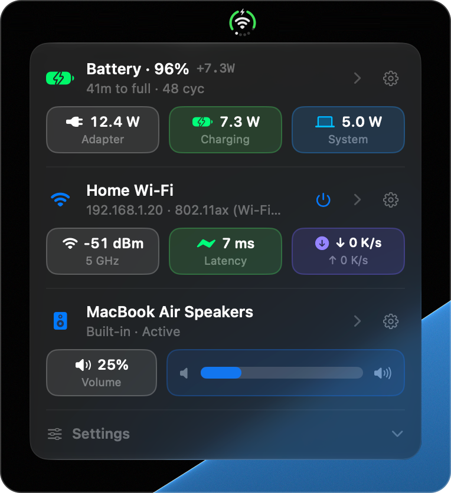
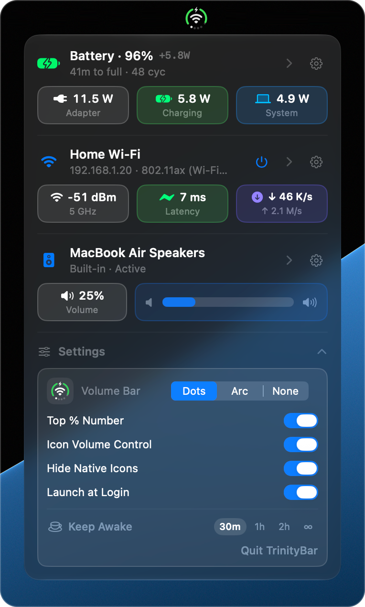

# TrinityBar

[](https://github.com/wangzechen/TrinityBar/actions/workflows/ci.yml)
[](https://github.com/wangzechen/TrinityBar/releases/latest)


[](./LICENSE)

**TrinityBar** is a lightweight (`~712 KB`), native macOS menu bar utility that unifies **Battery**, **Network**, and **Sound** into a single **`24pt`** status emblem paired with a two-layer **Liquid Glass** dashboard (`NSGlassEffectView` on macOS 26+, with automatic `NSVisualEffectView` and live `Reduce Transparency` fallbacks).

<p align="center">
  
  &nbsp;&nbsp;
  
</p>

---

## Features

### 1. Unified 24pt Menu Bar Emblem
- **Side Battery Brackets**: Symmetric left/right circular arcs showing live battery charge (`0–100%`) built from independent `CGPath` subpaths so the top crown cutout stays cleanly open behind numbers and icons:
  - **Green** with a lightning bolt while actively charging (`isCharging`)
  - **Green** with an AC plug glyph while held on external power (`isPluggedIn && !isCharging`)
  - **Yellow** in Low Power Mode or `<= 20%`, **Red** at `<= 15%`
  - Optional **Top `%` Number** (`SF Pro Rounded Bold`) with optical ink-bounds centering
  - **Desktop Mac AC Support**: On Macs without a built-in battery (Mac mini / Mac Studio / iMac / Mac Pro), renders a clean AC plug emblem without misleading battery rings
- **Center Network Core**: Live 3-bar Wi-Fi fan (`RSSI`-mapped), Wired Ethernet (`<->` badge), or Offline slash indicator
- **Bottom Volume Footer**: Switchable inside **Settings** between:
  - **`Dots`** *(default)* — 4 curved volume steps
  - **`Arc`** — continuous bottom volume sweep
  - **`None`** — hides the bottom volume bar and **automatically shows the native macOS Sound icon** in the status bar
- **Split-Layer Menu Bar Compositing**: Pairs an `isTemplate = true` vibrancy base with a non-template chromatic status overlay so monochrome strokes adapt natively to light/dark wallpapers while semantic battery colors remain vivid

### 2. Liquid Glass Summary & Drill-Down Pages
Every module on the primary popover shares a consistent `[Header Row] + [Rounded-10 Liquid Glass Sub-Cards]` layout and drills down into a second-layer detail page:

| Module | Summary Sub-Cards | Second-Layer Drill-Down Page |
| :--- | :--- | :--- |
| **Battery** | `Adapter` · `Charging / Discharging` · `System` (live Watts; AC-only cards on desktop Macs) | Cubic-Bezier **Sankey Power Flow** diagram (`Adapter/Battery -> Charging, System, Display, USB`), background SMC electrical & thermal sensors, live **High Energy Apps** (user apps via `proc_pid_rusage`), `Battery Settings…` link |
| **Network** | `Signal / Band` · `Latency` (`ms`) · `↓ / ↑ Throughput` (64-bit counters) | Quick Wi-Fi Power switch, live **Known / Other Networks** scanner with one-click **Known Wi-Fi** direct connect, Location Services prompt for SSID access, expandable **Connection Details** (`SSID`, `BSSID`, `Channel`, `SNR`, `PHY`, `Tx Rate`, `IPv4/v6`, `Router`, `DNS` — click any value to copy) |
| **Sound** | Tap-to-Mute `Volume %` card · Interactive **Capsule Volume Slider** (fixed-volume outputs such as HDMI or Multi-Output devices show `—` with a dimmed, inert slider and an empty emblem footer) | Instant **Output & Input** `CoreAudio` device switcher (MacBook Speakers, Bluetooth Headsets/AirPods, USB DACs, HDMI/AirPlay — automatically excludes internal virtual loopback drivers), expandable **Audio Details** |

### 3. Native Control Center Auto-Hide & Collapsible Settings
- **Hide Native Icons** *(enabled by default, persisted across restarts)*: Snapshots your existing macOS Control Center `WiFi`, `Battery`, and `Sound` menu bar visibility states before hiding them, and restores your exact pre-TrinityBar layout when toggled off or when TrinityBar exits (`Quit`, `⌘Q`, `SIGTERM`, `SIGINT`).
- **Safe on New macOS Versions**: Control Center's visibility settings are undocumented, so on a macOS major version TrinityBar hasn't been verified on, `Hide Native Icons` starts off and the Settings drawer explains why; turning it on opts in for that version.
- **Crash Recovery & Single Instance**: If TrinityBar is force-quit while icons are hidden, `TrinityBar --restore-native-icons` (or relaunching and quitting) brings them back. Launching a second copy exits quietly instead of fighting over the menu bar.
- **Collapsible Settings Drawer**: Houses `Volume Bar` (`Dots / Arc / None`) with a live emblem preview, `Top % Number`, `Icon Volume Control` (scroll-to-volume & `⌥`-Click mute on the menu bar icon), `Hide Native Icons`, `Launch at Login` (`SMAppService.mainApp`), timed `Keep Awake` (`30m / 1h / 2h / ∞` via `IOPMAssertion`, with a clock-style `29:59` / `1:29:59` countdown badge that ticks every second while the dashboard is open), and `Quit TrinityBar`, animated smoothly with zero frame-0 jump.

---

## Quick Interactions

| Action | Behavior |
| :--- | :--- |
| **Left-click** menu bar emblem | Toggle the Liquid Glass dashboard |
| **Scroll** on menu bar emblem | Smoothly adjust system output volume *(when `Icon Volume Control` is enabled)* |
| **`⌥`-click** (Option-click) emblem | Toggle system output mute *(when `Icon Volume Control` is enabled)* |
| **Right-click** (`⌃`-click) emblem | Show minimal `Quit TrinityBar (⌘Q)` menu |
| **Two-finger scroll** on Summary / Sound | Smoothly adjust system output volume |
| **Click** any copyable telemetry value | Copy `IPv4`, `IPv6`, `Router`, `DNS`, `SSID`, `BSSID`, etc. with `"Copied"` feedback |
| **Press `Esc`** | Step back (`Detail -> Summary -> Collapse Settings -> Close Panel`) |

---

## Installation

### System Requirements
- **Apple Silicon Mac** (`arm64` — M1 / M2 / M3 / M4 or newer)
- **macOS 26.0+**

### Option 1: Download Pre-built Release *(Recommended)*
1. Download **`TrinityBar-v<version>-macos-arm64.zip`** from the [**Latest GitHub Release**](https://github.com/wangzechen/TrinityBar/releases/latest).
2. Extract the archive and drag **`TrinityBar.app`** into **`/Applications`**.
3. Because the binary is ad-hoc signed without a paid Apple Developer ID certificate, clear macOS Gatekeeper's download quarantine flag once before first launch:
   ```zsh
   xattr -cr /Applications/TrinityBar.app
   open /Applications/TrinityBar.app
   ```

### Option 2: Build from Source
Requires Xcode Command Line Tools (`xcode-select --install`):

```zsh
git clone https://github.com/wangzechen/TrinityBar.git
cd TrinityBar
./scripts/build_app.sh
cp -R dist/TrinityBar.app /Applications/
open /Applications/TrinityBar.app
```

Contributors can run the unit tests with `swift test` (see [ARCHITECTURE.md §2.6](./ARCHITECTURE.md#26-testing--continuous-integration-tests-githubworkflows)); releases follow [RELEASING.md](./RELEASING.md).

> **Location Permission for Wi-Fi SSID**: macOS redacts Wi-Fi `SSID` and `BSSID` strings unless Location Services access is granted to the `.app` bundle. Open the **Wi-Fi** detail page inside TrinityBar and click the blue **Allow Location Access** banner if you want network names displayed.

### Uninstall & Preferences Reset
Quitting TrinityBar normally (`Quit TrinityBar`, `⌘Q`, or `SIGTERM`) automatically restores your native macOS `Wi-Fi`, `Battery`, and `Sound` menu bar icons.

- **Remove the app & saved preferences**:
  ```zsh
  killall TrinityBar 2>/dev/null || true
  /Applications/TrinityBar.app/Contents/MacOS/TrinityBar --restore-native-icons
  rm -rf /Applications/TrinityBar.app
  defaults delete com.zechen.trinitybar
  ```
  The `--restore-native-icons` step hands the native icons back to your own pre-TrinityBar settings even if TrinityBar previously crashed or was force-killed, so run it **before** `defaults delete`, which removes the saved snapshot. It does nothing if no icons are hidden.
- **Native icon recovery after a crash or `kill -9`** *(app still installed)*: run `/Applications/TrinityBar.app/Contents/MacOS/TrinityBar --restore-native-icons`, or simply launch TrinityBar again and quit it.
- **Last-resort manual recovery** *(snapshot already deleted; resets all three icons to "Show in Menu Bar")*:
  ```zsh
  for key in WiFi Battery Sound; do
    defaults -currentHost write com.apple.controlcenter "$key" -int 18
    defaults write com.apple.controlcenter "NSStatusItem Visible $key" -bool true
  done
  killall ControlCenter
  ```

---

## Project Structure

```text
TrinityBar/
├── .github/workflows/
│   ├── ci.yml                               # build_app.sh + check_docs.sh + swift build + swift test on every push/PR
│   └── release.yml                          # v* tag -> verify version.env -> draft GitHub release
├── LICENSE                                  # MIT License
├── Package.swift                            # SwiftPM manifest (macOS 26.0+)
├── README.md                                # Product overview, usage & build guide
├── ARCHITECTURE.md                          # System design, rendering mechanics & extension guide
├── RELEASING.md                             # Release checklist: tests, in-app checks, docs review, tagging
├── version.env                              # Single source of truth: MARKETING_VERSION & BUILD_NUMBER
├── assets/
│   ├── dashboard-summary.png                # Collapsed summary dashboard screenshot (generated)
│   └── dashboard-settings.png               # Expanded settings drawer screenshot (generated)
├── scripts/
│   ├── build_app.sh                         # Size-optimized swiftc bundler -> dist/TrinityBar.app
│   ├── check_docs.sh                        # CI check: README tree, no hard-coded versions, documented sizes
│   ├── generate_icon.swift                  # Deterministic 66 KB 1024x1024 AppIcon.icns generator
│   ├── capture_screenshots.sh               # Regenerates assets/ screenshots with privacy-safe demo network data
│   └── frame_screenshot.swift               # Rounded-card framing for captured screenshots
└── Sources/TrinityBar/
    ├── TrinityBarApp.swift                  # NSStatusItem split-layer host, icon gestures, Combine sync & lifecycle
    ├── Resources/
    │   └── AppIcon.icns                     # Minimalist 1024x1024 macOS squircle app icon (66 KB)
    ├── Models/
    │   ├── AppSettings.swift                # UserDefaults preferences, PanelRoute & clipboard state
    │   ├── LaunchOptions.swift              # --restore-native-icons mode & single-instance guard
    │   └── ScreenshotMode.swift             # TRINITYBAR_SCREENSHOT demo scenes for README screenshots
    ├── Monitors/
    │   ├── BatteryMonitor.swift             # IOPSCopyPowerSourcesInfo + AppleSmartBattery + background AppleSMC
    │   ├── NetworkMonitor.swift             # NWPathMonitor + CoreWLAN + SCDynamicStore + 64-bit sysctl counters
    │   ├── AudioVolumeMonitor.swift         # CoreAudio volume/mute + Output/Input device switching
    │   ├── CaffeinateManager.swift          # Timed IOKit IOPMAssertion display sleep prevention (30m/1h/2h/∞)
    │   └── SystemIconsManager.swift         # Table-driven Control Center icon hide/snapshot/restore
    └── Views/
        ├── TrinityEmblemView.swift          # 24pt CoreGraphics emblem renderer & SwiftUI preview
        ├── StatusFloatingPanel.swift        # Top-pinned Liquid Glass NSPanel with zero-flash resize
        ├── PopoverDashboardView.swift       # Root router, 3-module summary & Settings drawer
        ├── Components/
        │   ├── SharedUIComponents.swift     # SummaryGlassMetricCard, SummaryModuleHeaderRow, etc.
        │   └── SummaryMetricSections.swift  # PowerInfoBarSection, NetworkInfoBarSection, SoundInfoBarSection
        └── Pages/
            ├── BatteryDetailsPageView.swift # Sankey power flow + battery telemetry + high energy apps
            ├── NetworkDetailsPageView.swift # Wi-Fi scanner + expandable link telemetry
            └── SoundDetailsPageView.swift   # CoreAudio Output/Input switcher + audio stream telemetry
└── Tests/TrinityBarTests/                   # XCTest unit tests for pure logic (`swift test`)
    ├── BatteryAlertLevelTests.swift         # Charging / critical / low / normal thresholds
    ├── CaffeinateFormatTests.swift          # Keep Awake M:SS / H:MM:SS countdown formatting
    ├── LaunchOptionsTests.swift             # Launch flag parsing & single-instance detection
    ├── PowerSourceSelectionTests.swift      # Internal battery chosen over UPS / external sources
    ├── RoutablePublicIPTests.swift          # Latency-probe public vs private / CGNAT / ULA address filter
    ├── StatusFloatingPanelTests.swift       # Scroll-to-volume scaling & panel placement geometry
    ├── SystemIconsManagerTests.swift        # Native icon hide / snapshot / restore policy against fake prefs
    ├── TrinityStatusIconRendererTests.swift # Menu bar layers for every mode × connection × charging state
    ├── VolumeDisplayTests.swift             # Volume dots / arc / % text, muted and fixed-volume outputs
    └── WiFiSignalTests.swift                # RSSI -> bars and SF Symbol variable value
```

---

## Privacy & Permissions

- **Zero Telemetry & Zero Third-Party Dependencies**: Built exclusively against public macOS system frameworks (`AppKit`, `SwiftUI`, `IOKit`, `CoreWLAN`, `CoreAudio`, `Network`, `ServiceManagement`). No analytics, crash reporters, or external SDKs.
- **Location Services *(Optional)***: Requested only if you click **Allow Location Access** on the Wi-Fi page. macOS redacts Wi-Fi `SSID` and `BSSID` strings unless Location permission is granted; TrinityBar never reads or stores geographic coordinates.
- **Latency Probe *(Popover-Only)***: While the dashboard is open, network RTT is measured via a lightweight TCP handshake to your Mac's own configured public DNS server (falling back to Apple's global `captive.apple.com` connectivity endpoint when your DNS is a local LAN router). Zero probes run while the panel is closed.

---

## Architecture & Extension Guide

See [ARCHITECTURE.md](./ARCHITECTURE.md) for hardware data-source details, rendering internals, zero-flash `NSPanel` geometry, and step-by-step instructions on adding new modules or managed Control Center icons.

## License

Released under the [MIT License](./LICENSE).
